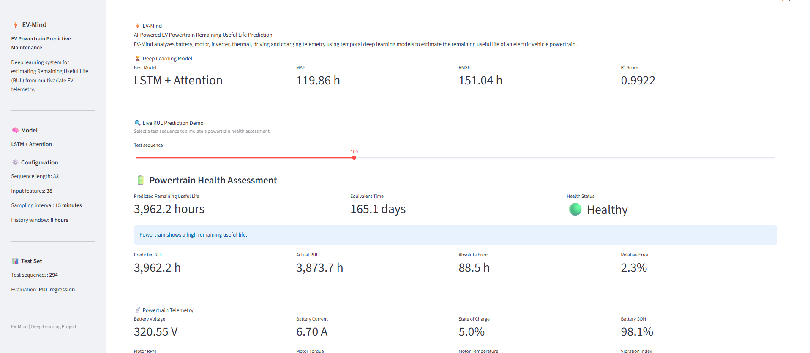
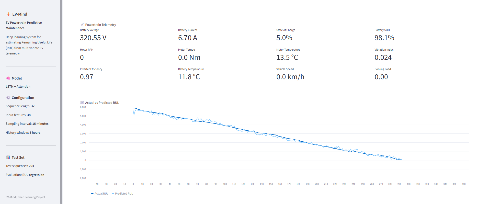
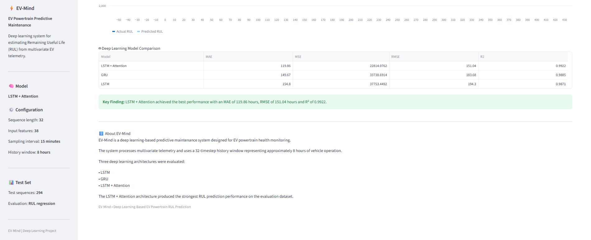

# EV-Mind
## AI-Powered EV Powertrain Remaining Useful Life Prediction

EV-Mind is a deep learning project that predicts the Remaining Useful Life (RUL) of an electric vehicle powertrain using historical telemetry data.

### Models
- LSTM
- GRU
- LSTM + Attention

### Technologies
Python, TensorFlow/Keras, NumPy, Pandas, Scikit-learn, Matplotlib and Streamlit.

### Best Model Results

| Metric | Result |
|---|---:|
| MAE | 119.86 hours |
| RMSE | 151.04 hours |
| R² Score | 0.9922 |

### Features
- EV telemetry data preprocessing
- Temporal sequence generation using 32 timesteps
- Deep learning model comparison
- RUL prediction in hours
- Interactive Streamlit dashboard

## 📸 Project Screenshots

### 1. EV-Mind Dashboard


### 2. Remaining Useful Life Prediction


### 3. Deep Learning Model Comparison


### Running the Project
Install the dependencies:

```bash
pip install -r requirements.txt
```

Run the preprocessing, training and results scripts using their actual paths in your project. Then launch the dashboard with:

```bash
streamlit run src/rul_app.py
```

### Note
The current dashboard demonstrates predictions using held-out test sequences from a dataset. It is not connected to a live electric vehicle.